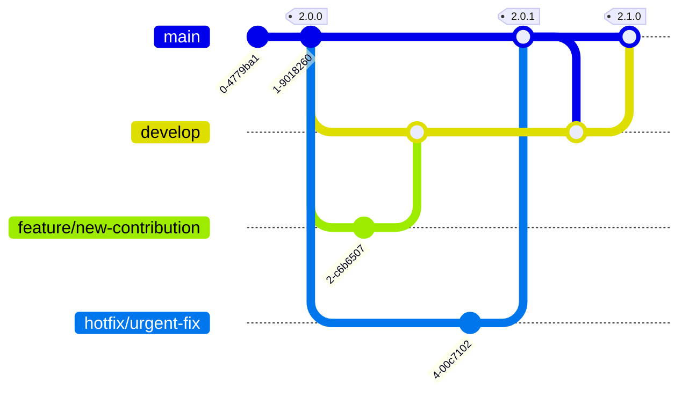
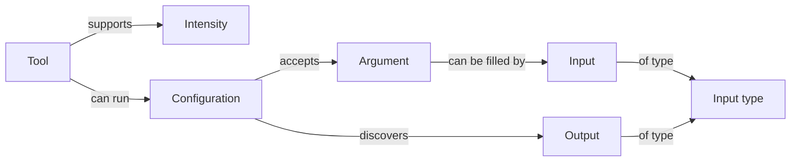

Rekono is an open-source project and welcomes contributions of all kinds — bug fixes, new hacking tool integrations, UI improvements, and more. This page explains the branching strategy used to keep the codebase stable, covers how to install every system dependency, and walks through the full development setup for the three sub-projects: `backend/` (Django REST API and RQ workers), `frontend/` (Nuxt 4 UI), and `email-templates/` (React Email templates compiled and consumed by the backend).

## Branching Strategy

Rekono uses a trunk-based workflow with two long-lived branches:

- **`main`** — always reflects a released version. Tagged on every release.
- **`develop`** — integration branch for the next release. All feature and bug-fix work targets this branch.

| Work type | Branch prefix | Target branch |
|---|---|---|
| New features | `feature/...` | `develop` |
| Bug fixes | `bugfix/...` | `develop` |
| Urgent hotfixes for released versions | `hotfix/...` | `main`, then merged back to `develop` |

The diagram below shows the full flow — feature branches merge into `develop`, hotfix branches merge into `main` (which is tagged) and then back into `develop`:



All pull requests must pass CI checks (linting, unit tests, coverage threshold) and receive at least one approval before being merged.

## Development Requirements

Rekono has three independent sub-projects, each with its own dependency tree. Install the following on your development machine before setting anything up:

| Dependency | Version | Used by |
|---|---|---|
| Python | 3.13+ | `backend/` |
| [uv](https://docs.astral.sh/uv/) | Latest | `backend/` — dependency manager and task runner |
| Node.js | 22+ | `frontend/`, `email-templates/` |
| [pnpm](https://pnpm.io/) | Latest | `frontend/`, `email-templates/` |
| PostgreSQL | Any (18 recommended) | `backend/` |
| Valkey | 8+ | `backend/` workers and tests |

Some Python packages require native system libraries. Install them before running `uv sync`:

<Tabs>
  <Tab title="Debian / Ubuntu">
    ```bash
    sudo apt install \
      libpq-dev \
      libmagic1 \
      libgcc-s1 \
      libxml2-dev \
      libxslt-dev \
      python3-dev \
      libjpeg-dev \
      zlib1g-dev
    ```
  </Tab>
  <Tab title="macOS">
    ```bash
    brew install libmagic
    ```
  </Tab>
</Tabs>

## Setting Up PostgreSQL and Valkey

Start both services and create the development database:

```bash
sudo systemctl enable --now postgresql valkey-server
sudo -u postgres psql
```

Inside the `psql` prompt, create the database user and database:

```sql
CREATE USER rekono WITH ENCRYPTED PASSWORD 'rekono';
CREATE DATABASE rekono;
ALTER DATABASE rekono OWNER TO rekono;
```

<Note>
  When `/opt/rekono` does not exist on the host, Rekono uses the repository root as its home directory. The `config.yaml` at the repository root is therefore the active configuration file. Set the database credentials there, or export the `RKN_DB_USER` and `RKN_DB_PASSWORD` environment variables. **Never commit real credentials to the repository.**
</Note>

## Backend Setup

All commands in this section are run from the `backend/` directory.

<Steps>
  <Step title="Install dependencies">
    ```bash
    uv sync --locked
    ```
  </Step>

  <Step title="Initialize the database">
    Run the Django migrations to create the schema and load the default fixtures (tools, processes, wordlists):

    ```bash
    uv run manage.py migrate
    ```

    After migrating, update the resource status to reflect what is actually installed on your machine:

    ```bash
    uv run manage.py remove_deprecated_steps
    uv run manage.py update_wordlists_size
    uv run manage.py update_tools_status
    ```
  </Step>

  <Step title="Create the initial admin user">
    ```bash
    uv run manage.py createsuperuser
    ```
  </Step>

  <Step title="Enqueue the first monitor job">
    Each monitor job only schedules the next one, so you need to enqueue the first one manually:

    ```bash
    uv run manage.py monitor
    ```
  </Step>

  <Step title="Run the development server">
    ```bash
    uv run manage.py runserver
    ```

    The API is available at `http://127.0.0.1:8000`. The interactive Swagger UI is at `http://127.0.0.1:8000/api/schema/swagger-ui/`.
  </Step>

  <Step title="Run the workers">
    Each worker must run in its own terminal session:

    ```bash
    # Tasks worker — coordinates scan scheduling
    uv run manage.py rqworker tasks --with-scheduler

    # Executions worker pool — runs the hacking tools (10 parallel workers)
    uv run manage.py rqworker-pool executions --num-workers 10

    # Findings worker — parses tool output and creates findings
    uv run manage.py rqworker findings

    # Monitor worker — keeps CVE data fresh and cleans stale executions
    uv run manage.py rqworker monitor --with-scheduler
    ```

    <Tip>
      All component logs except the frontend are written to `logs/rekono.log` in the backend directory.
    </Tip>
  </Step>
</Steps>

## Frontend Setup

All commands in this section are run from the `frontend/` directory. The development server proxies all `/api` requests to `http://127.0.0.1:8000`, so the backend must be running first.

<Steps>
  <Step title="Create the environment file">
    ```bash
    echo "NODE_ENV=development" > .env
    ```
  </Step>

  <Step title="Install dependencies">
    ```bash
    pnpm install
    ```
  </Step>

  <Step title="Start the development server">
    ```bash
    pnpm run dev
    ```

    The UI is available at `http://localhost:3000`.
  </Step>
</Steps>

## Email Templates Setup

The backend uses the **compiled HTML** output of the email templates, not the React source files. Build the templates at least once before running the backend (or whenever you modify a template). All commands are run from the `email-templates/` directory.

<Steps>
  <Step title="Install dependencies">
    ```bash
    pnpm install
    ```
  </Step>

  <Step title="Build the templates">
    ```bash
    pnpm run build
    ```

    This exports the rendered HTML templates to `backend/platforms/email/templates/`, where Django picks them up.
  </Step>

  <Step title="Watch for changes (optional)">
    During active template development, run the dev server to rebuild automatically on every save:

    ```bash
    pnpm run dev
    ```
  </Step>
</Steps>

## Running the Test Suite

The backend test suite uses an in-memory SQLite database, so only Valkey needs to be running. Tests run in parallel to keep the suite fast.

```bash
# backend/
uv run coverage run --concurrency=multiprocessing,thread manage.py test --parallel 50
uv run coverage combine && uv run coverage report -m --skip-covered
```

<Note>
  **New code requires unit tests, and the total coverage must stay above 95%.** This threshold is enforced in CI; pull requests that drop coverage below 95% will not be merged.
</Note>

## Code Style

Install the pre-commit hooks once to run formatters and linters automatically before every commit:

```bash
python3 -m pip install pre-commit && pre-commit install
```

You can also run them manually:

<Tabs>
  <Tab title="Backend">
    ```bash
    uvx ruff format
    uvx ruff==0.15.22 check --fix
    uvx ruff check --select I --fix
    ```
  </Tab>
  <Tab title="Frontend">
    ```bash
    pnpm run prettier:fix
    pnpm run eslint:fix
    ```
  </Tab>
  <Tab title="Email Templates">
    ```bash
    pnpm run prettier:fix
    pnpm run eslint:fix
    ```
  </Tab>
</Tabs>

All backend code (except tests and migrations) must include docstrings following the [Google Python Style Guide](https://google.github.io/styleguide/pyguide.html#38-comments-and-docstrings). Frontend code must **not** include comments, as they would be exposed to end users.

## Agentic Development

The [pablosnt/skills](https://github.com/pablosnt/skills) repository contains skills specialized in Rekono development — covering integrations, frontend pages, unit tests, and docstrings — that make coding with AI agents significantly more accurate. The `skills-lock.json` file in the repository root pins every skill this project uses. Install them into your environment with:

```bash
npx skills@latest experimental_install
```

## Common Contributions

### Adding a New Hacking Tool

A tool is defined entirely by data in the `backend/tools/` directory. The relationships between the data entities are:



A **tool** can do several things, each one a **configuration** with its own command template. Every placeholder in that template is an **argument**, and each argument declares the **inputs** that can fill it (in priority order), pointing to the **input type** that provides the data. **Intensities** map Rekono intensity levels to the arguments of the tool. **Outputs** declare what the configuration discovers, enabling a process to chain its configurations.

Data files and how they are loaded:

| File | Loaded by |
|---|---|
| `data/1_tools.json` | A migration, since configurations reference tools |
| `data/3_configurations.json` | A migration, since steps and executions reference configurations |
| `fixtures/2_intensities.json` | Django fixtures, recreated on every `migrate` |
| `fixtures/4_arguments.json` | Django fixtures, recreated on every `migrate` |
| `fixtures/5_inputs.json` | Django fixtures, recreated on every `migrate` |
| `fixtures/6_outputs.json` | Django fixtures, recreated on every `migrate` |

Steps to add a new tool:

1. Add the tool to `data/1_tools.json` and its configurations to `data/3_configurations.json`, with the next free `pk` and a `migration` key naming the migration that will create them.
2. Add its intensities, arguments, inputs, and outputs to the fixture files. Arguments are written with the input keywords from `backend/framework/enums.py`, for example `-p {ports_commas}`.
3. Create the migration in `backend/tools/migrations/`, copying the pattern of `0004_remove_argument_unique_argument_and_more.py`. It writes only the entries whose `migration` key names it, using `update_or_create`.
4. Add the tool to the default processes in a new migration of the `processes` app.
5. Create the parser in `backend/tools/parsers/`, extending `BaseParser` and implementing `_parse`. The class name is the tool name without spaces, which is how it is resolved.
6. Create an executor in `backend/tools/executors/` **only if the tool misbehaves or has special requirements** (for example, Nikto writes its report to a non-standard location). Most tools do not need one.
7. Add unit tests: place an anonymized tool report in `backend/tests/data/reports/<tool_name>/` and write the test case in `backend/tests/parsers/`.
8. Add the tool installation to `docker/Dockerfile`.
9. Add the tool's icon domain to the `img-src` directive of the CSP in `docker/nginx/nginx.conf`.
10. Add the tool to the [README](https://github.com/pablosnt/rekono/blob/main/README.md).

### Updating a Tool

Intensities, arguments, inputs, and outputs are reloaded after every `migrate`, so editing the fixture file is sufficient for those.

Tools and configurations are not reloaded automatically. Edit the entry and create a new migration to ensure that users who already have the old tool metadata in their database receive the updated metadata when they upgrade.

### Removing a Tool

**Identifiers must stay consistent — entries are never deleted.** Deleting a configuration would cascade-delete the scans and executions that used it. Instead, mark the tool's configurations as `deprecated` following the [update a tool](#updating-a-tool) procedure, and remove their arguments, inputs, outputs, and intensities from the fixture files. A tool with no active configurations disappears from the API while all historical data that referenced it continues to work.

### Adding a New Integration

Integrations with external platforms live in `backend/platforms/` and extend one of these base classes from `backend/framework/platforms.py`:

- `BaseIntegration` — to enrich findings or sync them elsewhere (for example, VirusTotal or Defect-Dojo).
- `BaseCveProvider` — to enrich vulnerabilities with CVE data (for example, NVD NIST or OSV).
- `BaseNotification` — to notify users (for example, SMTP or Telegram).

An integration that requires nothing from the user is a single file (for example, `platforms/osv.py`). One that requires credentials or settings is a Django app (for example, `platforms/virustotal/`) with its own model, serializer, view, URLs, and migration.

In both cases, register the new integration by:

1. Adding its entry to the `Integration` table in a new migration of the `integrations` app. The `key` must be the class name in lowercase, as that is how the integration locates itself.
2. Adding the integration to the appropriate list in `backend/findings/queues.py`.
3. Adding tests in `backend/tests/platforms/` and updating `backend/tests/test_integrations.py`.
4. Adding its settings form to `frontend/app/components/admin/integrations.vue`.
5. Adding its icon domain to the `img-src` directive of the CSP in `docker/nginx/nginx.conf`.

## Way of Code

Following these principles keeps the codebase consistent and maintainable:

- **Keep the code style**, and reuse what is already there instead of duplicating it.
- **Keep it simple.** Do not overcomplicate the code.
- **Document the backend, don't comment the frontend.** Backend code needs docstrings; frontend comments would be exposed to users.
- **Add a CHANGELOG entry** with your change under the appropriate version heading.
- **Test your code**, and keep the total coverage above 95%.
- **Security first.** Rekono is a cybersecurity project — do not introduce vulnerabilities or add vulnerable dependencies.
- **All pull requests** must pass CI checks and receive at least one approval before being merged.

<Note>
  If you find a security vulnerability in Rekono, **do not open a public issue or pull request**. Follow the instructions in `SECURITY.md` to report it privately. Public disclosure before a fix is available puts all Rekono deployments at risk.
</Note>
