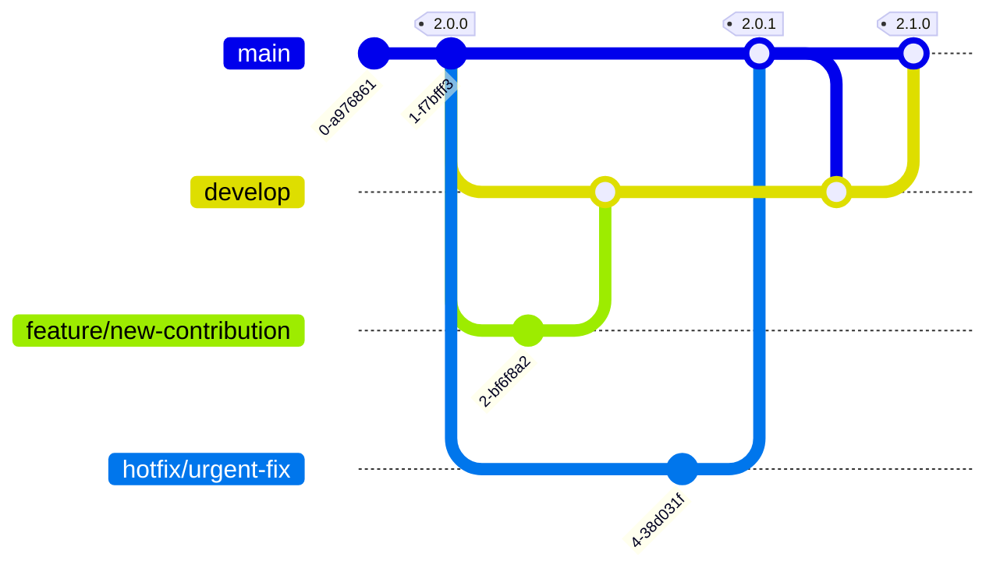

Rekono is an open-source project and welcomes contributions of all kinds — bug fixes, new hacking tool integrations, UI improvements, and more. This page explains the branching strategy used to keep the codebase stable, covers how to install every system dependency, and walks through the full development setup for the three sub-projects: `backend/` (Django REST API and RQ workers), `frontend/` (Nuxt 4 UI), and `email-templates/` (React Email templates compiled and consumed by the backend).

## Branching Strategy

Rekono uses a trunk-based workflow with two long-lived branches:

- **`main`** — always reflects a released version. Tagged on every release.
- **`develop`** — integration branch for the next release. All feature and bug-fix work targets this branch.

| Work type | Branch prefix | Target branch |
|---|---|---|
| New features | `feature/...` | `develop` |
| Bug fixes | `bugfix/...` | `develop` |
| Urgent hotfixes for released versions | `hotfix/...` | `main`, then merged back to `develop` |

The diagram below shows the full flow — feature branches merge into `develop`, hotfix branches merge into `main` (which is tagged) and then back into `develop`:



All pull requests must pass CI checks (linting, unit tests, coverage threshold) and receive at least one approval before being merged.

## Development Requirements

Rekono has three independent sub-projects, each with its own dependency tree. Install the following on your development machine before setting anything up:

| Dependency | Version | Used by |
|---|---|---|
| Python | 3.13+ | `backend/` |
| [uv](https://docs.astral.sh/uv/) | Latest | `backend/` — dependency manager and task runner |
| Node.js | 22+ | `frontend/`, `email-templates/` |
| [pnpm](https://pnpm.io/) | Latest | `frontend/`, `email-templates/` |
| PostgreSQL | Any (18 recommended) | `backend/` |
| Valkey | 8+ | `backend/` workers and tests |

Some Python packages require native system libraries. Install them before running `uv sync`:

<Tabs>
  <Tab title="Debian / Ubuntu">
    ```bash
    sudo apt install \
      libpq-dev \
      libmagic1 \
      libgcc-s1 \
      libxml2-dev \
      libxslt-dev \
      python3-dev \
      libjpeg-dev \
      zlib1g-dev
    ```
  </Tab>
  <Tab title="macOS">
    ```bash
    brew install libmagic
    ```
  </Tab>
</Tabs>

## Setting Up PostgreSQL and Valkey

Start both services and create the development database:

```bash
sudo systemctl enable --now postgresql valkey-server
sudo -u postgres psql
```

Inside the `psql` prompt, create the database user and database:

```sql
CREATE USER rekono WITH ENCRYPTED PASSWORD 'rekono';
CREATE DATABASE rekono;
ALTER DATABASE rekono OWNER TO rekono;
```

<Note>
  When `/opt/rekono` does not exist on the host, Rekono uses the repository root as its home directory. The `config.yaml` at the repository root is therefore the active configuration file. Set the database credentials there, or export the `RKN_DB_USER` and `RKN_DB_PASSWORD` environment variables. **Never commit real credentials to the repository.**
</Note>

## Backend Setup

All commands in this section are run from the `backend/` directory.

<Steps>
  <Step title="Install dependencies">
    ```bash
    uv sync --locked
    ```
  </Step>

  <Step title="Initialize the database">
    Run the Django migrations to create the schema and load the default fixtures (tools, processes, wordlists):

    ```bash
    uv run manage.py migrate
    ```

    After migrating, update the resource status to reflect what is actually installed on your machine:

    ```bash
    uv run manage.py remove_deprecated_steps
    uv run manage.py update_wordlists_size
    uv run manage.py update_tools_status
    ```
  </Step>

  <Step title="Create the initial admin user">
    ```bash
    uv run manage.py createsuperuser
    ```
  </Step>

  <Step title="Enqueue the first monitor job">
    Each monitor job only schedules the next one, so you need to enqueue the first one manually:

    ```bash
    uv run manage.py monitor
    ```
  </Step>

  <Step title="Run the development server">
    ```bash
    uv run manage.py runserver
    ```

    The API is available at `http://127.0.0.1:8000`. The interactive Swagger UI is at `http://127.0.0.1:8000/api/schema/swagger-ui/`.
  </Step>

  <Step title="Run the workers">
    Each worker must run in its own terminal session:

    ```bash
    # Tasks worker — coordinates scan scheduling
    uv run manage.py rqworker tasks --with-scheduler

    # Executions worker pool — runs the hacking tools (10 parallel workers)
    uv run manage.py rqworker-pool executions --num-workers 10

    # Findings worker — parses tool output and creates findings
    uv run manage.py rqworker findings

    # Monitor worker — keeps CVE data fresh and cleans stale executions
    uv run manage.py rqworker monitor --with-scheduler
    ```

    <Tip>
      All component logs except the frontend are written to `logs/rekono.log` in the backend directory.
    </Tip>
  </Step>
</Steps>

## Frontend Setup

All commands in this section are run from the `frontend/` directory. The development server proxies all `/api` requests to `http://127.0.0.1:8000`, so the backend must be running first.

<Steps>
  <Step title="Create the environment file">
    ```bash
    echo "NODE_ENV=development" > .env
    ```
  </Step>

  <Step title="Install dependencies">
    ```bash
    pnpm install
    ```
  </Step>

  <Step title="Start the development server">
    ```bash
    pnpm run dev
    ```

    The UI is available at `http://localhost:3000`.
  </Step>
</Steps>

## Email Templates Setup

The backend uses the **compiled HTML** output of the email templates, not the React source files. Build the templates at least once before running the backend (or whenever you modify a template). All commands are run from the `email-templates/` directory.

<Steps>
  <Step title="Install dependencies">
    ```bash
    pnpm install
    ```
  </Step>

  <Step title="Build the templates">
    ```bash
    pnpm run build
    ```

    This exports the rendered HTML templates to `backend/platforms/email/templates/`, where Django picks them up.
  </Step>

  <Step title="Watch for changes (optional)">
    During active template development, run the dev server to rebuild automatically on every save:

    ```bash
    pnpm run dev
    ```
  </Step>
</Steps>

## Running the Test Suite

The backend test suite uses an in-memory SQLite database, so only Valkey needs to be running. Tests run in parallel to keep the suite fast.

```bash
# backend/
uv run coverage run --concurrency=multiprocessing,thread manage.py test --parallel 50
uv run coverage combine && uv run coverage report -m --skip-covered
```

<Note>
  **New code requires unit tests, and the total coverage must stay above 95%.** This threshold is enforced in CI; pull requests that drop coverage below 95% will not be merged.
</Note>

## Code Style

Install the pre-commit hooks once to run formatters and linters automatically before every commit:

```bash
python3 -m pip install pre-commit && pre-commit install
```

You can also run them manually:

<Tabs>
  <Tab title="Backend">
    ```bash
    uvx ruff format
    uvx ruff==0.15.22 check --fix
    uvx ruff check --select I --fix
    ```
  </Tab>
  <Tab title="Frontend">
    ```bash
    pnpm run prettier:fix
    pnpm run eslint:fix
    ```
  </Tab>
  <Tab title="Email Templates">
    ```bash
    pnpm run prettier:fix
    pnpm run eslint:fix
    ```
  </Tab>
</Tabs>

All backend code (except tests and migrations) must include docstrings following the [Google Python Style Guide](https://google.github.io/styleguide/pyguide.html#38-comments-and-docstrings). Frontend code must **not** include comments, as they would be exposed to end users.

<Note>
  If you find a security vulnerability in Rekono, **do not open a public issue or pull request**. Follow the instructions in `SECURITY.md` to report it privately. Public disclosure before a fix is available puts all Rekono deployments at risk.
</Note>
